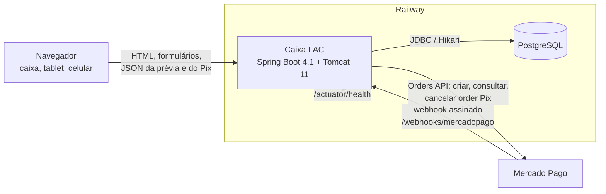
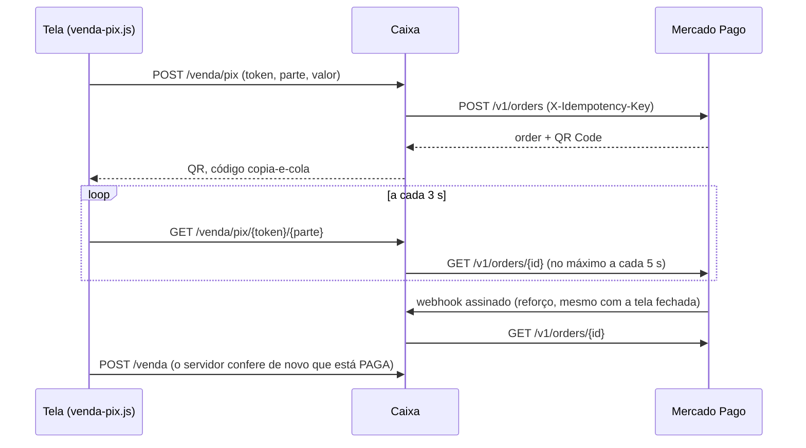

# Arquitetura do Caixa LAC


## 1. Visão geral

Uma aplicação web monolítica em Spring Boot, renderizada no servidor
(Thymeleaf), com um pouco de JavaScript nas telas que precisam reagir na hora
(venda, Pix, gráficos, avisos). Um processo só, um banco só.



- **Estado:** todo no banco, exceto a sessão de login e o freio de tentativas de
  senha, que ficam na memória do processo (por isso o Railway roda **uma**
  réplica).
- **Dinheiro:** sempre `BigDecimal` em reais com 2 casas (custo com 4), ou
  `long` em centavos dentro da calculadora de preço; arredondamento HALF_EVEN.
- **Hora:** sempre a de Brasília, pelo `Clock` da aplicação (seção 9).

## 2. Stack

| Camada | Tecnologia | Versão |
|---|---|---|
| Linguagem | Java | 21 |
| Framework | Spring Boot | 4.1.2 |
| | Spring Framework (MVC, transações, `RestClient`) | 7.0.10 |
| Servidor HTTP | Tomcat embutido | 11.0.27 |
| Telas | Thymeleaf (+ `thymeleaf-spring6`) | 3.1.5 |
| JSON | Jackson 3 (`tools.jackson`) | 3.1.7 |
| Persistência | Spring Data JPA / Hibernate ORM / Jakarta Persistence | 4.1.2 / 7.4.13 / 3.2 |
| Pool de conexões | HikariCP | 7.0.2 |
| Validação | Hibernate Validator (Bean Validation) | 9.1.5 |
| Migrações | Flyway | 12.4.0 |
| Banco em produção | PostgreSQL (driver JDBC) | 16 nos testes / driver 42.7.14 |
| Banco no computador | H2 em arquivo | 2.3.232 |
| Saúde | Spring Boot Actuator (só `/actuator/health`) | 4.1.2 |
| Gráficos | Chart.js, embutido em `static/js/vendor/` | 4.4.1 |
| Testes | JUnit Jupiter / Mockito / MockMvc | 6.0.3 / 5.23.0 |
| | Testcontainers (`testcontainers-postgresql`) | 2.0.5 |
| | Playwright para Java (Chromium) | 1.64.0 |
| | OkHttp MockWebServer (Mercado Pago falso) | 4.12.0 |
| | ArchUnit | 1.5.1 |
| Qualidade | Spotless (palantir-java-format 2.103.0) / JaCoCo | 3.10.4 / 0.8.16 |
| Build | Maven Wrapper 3.3.4 com Maven | 3.9.9 |
| CI | GitHub Actions (`.github/workflows/ci.yml`) | |
| Hospedagem | Railway (Railpack), `railway.json` com healthcheck | |

## 3. Organização do código

```
src/main/java/br/com/lac/caixa/
├── CaixaApplication        ponto de entrada (fixa o fuso e sobe o Spring)
├── config/                 senha, login, filtro de origem, relógio, dados iniciais
├── controle/               controllers MVC e JSON (uma tela = um controller)
│   └── csv/                geração e download dos CSVs
├── servico/                regras de negócio e transações
│   ├── preco/              calculadora de preço e busca de pacotes (Java puro)
│   └── financas/           contas das finanças, por assunto
├── consulta/               records de filtro (histórico, finanças, período do evento)
├── repositorio/            Spring Data, Specifications, Criteria e SQL das finanças
├── modelo/                 entidades JPA com as regras de cada uma
│   └── pagamento/          Strategy de descrição de cada forma de pagamento
├── dominio/                exceções de negócio
├── pix/                    cliente do Mercado Pago e assinatura do webhook
└── util/                   Dinheiro, Rateio, GraficoSvg (ferramentas sem dependência)

src/main/resources/
├── application*.properties perfis local, prod (e test em src/test)
├── db/migration/           migrações Flyway comuns (H2 e PostgreSQL)
├── db/migration-postgresql/ migrações só do PostgreSQL (V20, V22)
├── templates/              telas Thymeleaf (+ fragments/ com layout e pedaços de Finanças)
└── static/                 css/estilo.css, js/*.js, js/vendor/, img/
```

**Regras de dependência**, conferidas em todo build pelo `ArquiteturaTest`
(ArchUnit):

- nenhum ciclo entre os pacotes de primeiro nível;
- `modelo` e `dominio` não conhecem serviço, repositório, controle nem web;
- `repositorio` não conhece serviço nem controle;
- `servico` não conhece controle;
- `controle` não conhece repositório (fala só com serviços e filtros de `consulta`);
- `util` não depende de serviço, repositório, controle nem modelo;
- `modelo.pagamento` só depende de `FormaPagamento`, de `util` e do Java.

## 4. Domínio

Entidades JPA (`modelo/`), com as regras perto dos dados:

| Entidade | Papel |
|---|---|
| `Produto`, `Categoria` | Item do estoque (preço, quantidade, custo médio com 4 casas, limite de estoque baixo, arquivado) e sua categoria de nome padronizado ("BÓTON" = "bóton"). |
| `MovimentoEstoque`, `CompraEstoque` | Livro do estoque (cada mudança com sinal) e entradas por compra com o custo médio antes e depois. |
| `Promocao`, `PromocaoItem` | Promoção por categoria: `A_PARTIR_DE` ou `PACOTE`, com quantas unidades de cada categoria entram. |
| `Venda`, `ItemVenda`, `VendaDesconto` | A venda (calculado, desconto, cobrado, ajuste, cancelamento, token), os itens com preço, custo e desconto congelados, e os descontos promocionais da época. |
| `PagamentoVenda` | Cada parte do pagamento: forma, valor, troco, origem do Pix (Mercado Pago ou manual), id da order e taxa estimada. |
| `CobrancaPix` | A cobrança Pix de uma parte de uma venda em andamento no Mercado Pago. |
| `Evento` | Evento com início e fim `[inicio, fim)`; sem fim = em andamento. Metas opcionais. |
| `Despesa`, `CategoriaDespesa` | Despesas do grupo, com evento opcional. |
| `TaxaPagamento` | Taxa de uma forma de pagamento (percentual + fixo) com vigência. |

Padrões visíveis (o projeto nasceu como trabalho de POO):

- **Strategy** em `modelo/pagamento/`: cada forma de pagamento sabe se descrever
  (`"R$ 10,00 via Pix"`, `"Dinheiro R$ 8,00 (troco R$ 2,00)"`). As estratégias
  recebem `DadosDaParte` (forma, valor, descrição, troco), não a entidade.
- **Factory**: `PagamentoFactory` escolhe a estratégia pela forma e monta a
  mensagem de confirmação.
- **Singleton**: cada `@Service` é uma instância única mantida pelo Spring.
- **Records** para dados sem identidade: filtros, orçamento da calculadora,
  resultados das finanças, linhas de CSV.
- **Exceção de negócio**: `RegraDeNegocioException` carrega a mensagem para a
  pessoa no caixa; qualquer outra exceção é erro de programa ("Algo deu errado",
  pilha no log).

## 5. Fluxos principais

### 5.1 Venda

1. `GET /venda/nova` desenha a tela com um **token** (UUID) novo.
2. A cada mudança no carrinho, o `venda.js` chama `POST /venda/previa`, e a
   `CalculadoraDePreco` devolve o orçamento em JSON (itens com preço aplicado,
   descontos, total, se é aproximado). O navegador nunca calcula preço.
3. `POST /venda` (`CaixaService.registrarVenda`, numa transação):
   - token já gravado → devolve a venda existente (reenvio não duplica);
   - resolve os produtos, calcula de novo o orçamento no servidor e confere o
     ajuste manual (motivo obrigatório);
   - confere as partes do pagamento (soma exata, troco, Pix do Mercado Pago
     pago com o mesmo valor) e grava a taxa vigente de cada parte;
   - baixa o estoque com `UPDATE ... WHERE quantidade >= :q` (atômico) e cria os
     itens; rateia o desconto entre os itens pelo maior resto;
   - grava a venda, os movimentos de saída e a linha de auditoria.
4. Se a venda é recusada (estoque acabou, Pix não pago, conflito), a tela volta
   com status 409, o mesmo carrinho e o mesmo token.

### 5.2 Calculadora de preço (`servico/preco`)

Java puro, sem Spring nem banco. Regra: o cliente paga o **menor total
possível** e cada unidade entra em **no máximo uma promoção**. A calculadora
aplica direto as `A_PARTIR_DE` que não disputam categoria com pacotes, enumera
os subconjuntos das outras e, para cada um, resolve os pacotes sobre as unidades
que sobraram (`BuscaDePacotes`, programação dinâmica iterativa). Acima de um
orçamento de 3 milhões de estados (ou mais de 12 `A_PARTIR_DE` disputando), usa
a melhor de duas heurísticas gulosas e marca o orçamento como **aproximado**,
sem recusar a venda. O `CalculadoraForcaBrutaTest` compara com uma força bruta
independente em carrinhos aleatórios.

### 5.3 Pix pelo Mercado Pago



- `MercadoPagoPix` usa o `RestClient` com timeout de 5 s e repete uma vez em
  caso de 429; qualquer falha vira `MercadoPagoException` e a tela oferece o
  Pix manual.
- `CobrancaPixService` **nunca chama o Mercado Pago com a linha travada**:
  consulta primeiro e depois aplica numa transação curta (`REQUIRES_NEW` +
  `PESSIMISTIC_WRITE`), conferindo que a order ainda é a mesma.
- A cobrança só vira `PAGA` com o valor exato; estorno e contestação viram
  `ESTORNADA`. Se o Mercado Pago recusar um cancelamento (409, em
  processamento), ela continua `PENDENTE` e a troca de valor é recusada.
- O webhook confere o `x-signature` (HMAC-SHA256, tempo constante, tolerância
  de tempo), responde 200 na hora e atualiza em segundo plano. O id da order
  vem só do `data.id` da URL, que é assinado.
- `LimpezaDePix` (agendada a cada 5 min) encerra cobranças pendentes há mais de
  20 min. Pix pago que não virou venda (ou cuja venda foi cancelada) aparece no
  histórico como "Pix recebido sem venda", para alguém resolver à mão.

### 5.4 Finanças

As somas são feitas no banco por `ConsultasFinanceiras` (SQL que roda igual no
PostgreSQL e no H2, montado só com os filtros preenchidos). Os serviços de
`servico/financas` cuidam de arredondamento, percentuais, ordenação e pontos
vazios:

| Serviço | Responsável por |
|---|---|
| `ResumoFinanceiro` | resumo, comparação com o período anterior, demonstrativo, metas e comparativo de eventos |
| `SerieFinanceira` | série por hora, dia, semana ou mês e o mapa de calor |
| `RankingsFinanceiros` | produtos, categorias, curva ABC, formas de pagamento e promoções |
| `EstoqueFinanceiro` | giro, cobertura, produtos parados e valor do estoque |
| `OcorrenciasFinanceiras` | vendas canceladas e ajustes manuais |
| `PainelFinancas` | monta a tela e o JSON dos gráficos; busca cada consulta uma vez |
| `RelatorioDoEvento` | o relatório para imprimir, com gráficos em SVG gerados no servidor |

O `ConsultasDaTelaFinancasTest` conta as consultas de cada pedido e trava o
máximo (a tela inteira, o JSON dos gráficos e o CSV de uma tabela).

## 6. Persistência

- **Esquema versionado pelo Flyway**; o Hibernate só valida
  (`ddl-auto=validate`). `db/migration` roda em todos os bancos e
  `db/migration-postgresql` só no PostgreSQL (`spring.flyway.locations` com
  `{vendor}`). Migração aplicada nunca é editada: o Flyway confere o checksum.
  Histórico e roteiro em [MIGRACOES.md](MIGRACOES.md) e [DEPLOY.md](DEPLOY.md).
- **Quatro jeitos de consultar**, cada um onde serve melhor:
  - Spring Data com JPQL em text blocks para o dia a dia (`*Repository`);
  - `Specification` (`VendaSpecs`) para o filtro do histórico, que só inclui o
    que foi preenchido;
  - Criteria com `Tuple` (`VendaConsultasImpl`) para as somas do histórico e do
    fechamento;
  - `NamedParameterJdbcTemplate` (`ConsultasFinanceiras`) para as agregações das
    finanças.
- **Concorrência**: versão otimista (`@Version`) em `Produto` e `Venda`; baixa e
  devolução de estoque atômicas; `PESSIMISTIC_WRITE` na venda (cancelamento) e
  na cobrança Pix; índice único do token da venda; índice único parcial
  `ux_evento_aberto` (só um evento em andamento) no PostgreSQL.
- `spring.jpa.open-in-view=false`: tudo o que a tela usa é carregado dentro da
  transação; coleções preguiçosas em lotes de 100
  (`default_batch_fetch_size`).
- **Integridade no banco**: `CHECK`s de valores (preço > 0, forma válida, troco
  só em dinheiro...), chaves estrangeiras e `NOT NULL` nas migrações, além das
  validações no serviço.

## 7. Web e telas

- **Controllers** finos: leem a requisição, chamam um serviço e preenchem o
  `Model`. Erros de negócio voltam como mensagem na tela de origem
  (`ErrosDeNegocio`) ou como `{"erro": "..."}` para o JavaScript.
- **Telas** em Thymeleaf, com um layout comum (`fragments/layout.html`: barra,
  menu Finanças, evento em andamento, sininho). Tema claro e escuro por tokens
  CSS em `estilo.css`.
- **JavaScript sem framework**, um arquivo por tela: `venda.js` (carrinho,
  prévia, pagamento dividido), `venda-pix.js` (painel do Pix), `financas.js`
  (gráficos e tabelas) e `avisos.js` (sininho). Dados do servidor chegam por
  atributos `data-`.
- **Estáticos** com o hash do conteúdo na URL e cache de um ano.
- **JSON**: prévia da venda, Pix, `/financas/dados` e `/avisos`.
- **CSV** (`controle/csv`): estoque, histórico, fechamento e cada tabela de
  Finanças (`TabelaCsv`), com `;`, BOM UTF-8, vírgula decimal e proteção contra
  fórmula em planilha (`LinhaCsv` / `ExportadorCSV.campo`).

Rotas principais: `/` (início), `/caixa` e `/venda/nova` (vender), `/estoque`,
`/descontos`, `/historico`, `/fechamento`, `/eventos` (e `/eventos/{id}/relatorio`,
`/eventos/comparativo`), `/financas`, `/despesas`, `/taxas`, `/login`,
`/webhooks/mercadopago` e `/actuator/health`.

## 8. Segurança

- **Login** com uma senha única (`APP_SENHA`), obrigatória em todos os perfis e
  conferida em tempo constante; sem ela a aplicação não sobe. O
  `AutenticacaoInterceptor` exige login em tudo, exceto login, logout,
  estáticos, health e webhook (o `SegurancaHttpTest` percorre todas as rotas).
- **Freio de tentativas** (`LimiteLogin`): espera progressiva por IP, bloqueio
  depois de 20 erros em 10 min, IPv6 agrupado por /64, teto global de 60 erros
  por minuto.
- **Sessão**: só por cookie, 12 h, id trocado no login, `SameSite=Strict` e
  `Secure` em produção; logout só por POST.
- **POST de outro site** recusado com 403 (`OrigemDoPost`: `Sec-Fetch-Site` e
  `Origin`).
- **Atrás do proxy do Railway**: `server.forward-headers-strategy=native`, para o
  freio contar o IP real.
- **Segredos** (senha, token e assinatura do Mercado Pago) só em variáveis de
  ambiente, nunca no código nem no log.
- **Auditoria**: o logger `auditoria` grava uma linha por venda, ajuste,
  correção de data, cancelamento e mudança de cadastro, só depois do commit.
- **Actuator**: só `/actuator/health`, `{"status":"UP"}`, sem detalhes nem sondas.

## 9. Tempo e fuso

O relógio da aplicação (`RelogioConfig`) é sempre `America/Sao_Paulo`, e o `main`
fixa o fuso da JVM antes de subir o Spring. As colunas de data são `TIMESTAMP`
sem fuso guardando a hora de Brasília. Todo código que precisa de "agora" recebe
o `Clock`, e os testes trocam por um relógio controlado (`RelogioDeTeste`).

## 10. Configuração e perfis

| Perfil | Banco | Uso |
|---|---|---|
| `local` (padrão) | H2 em arquivo `./dados/caixa`, console H2, escuta só em 127.0.0.1 | computador de quem desenvolve; cria produtos de exemplo |
| `prod` | PostgreSQL do Railway | produção; cookie seguro e proxy |
| `test` | H2 em memória (ou PostgreSQL via Testcontainers) | a suíte de testes, com senha própria |

As variáveis de ambiente estão listadas em [DEPLOY.md](DEPLOY.md).

## 11. Testes e CI

Cerca de 400 testes em 78 classes, rodados por `./mvnw -B verify`:

| Tipo | Onde | O que garante |
|---|---|---|
| Unidade | `modelo`, `servico/preco`, `util`, `config` | regras das entidades, calculadora (inclusive contra força bruta), rateio, freio de login |
| Serviço e HTTP | `servico`, `controle`, `financas` (MockMvc, H2) | fluxos completos das telas, mensagens, CSVs, segurança das rotas |
| Massa fixa das finanças | `MassaFinanceira` | resultados calculados à mão, no H2 e no PostgreSQL |
| Saídas esperadas | `SaidasEsperadasTest` | JSON da prévia, das finanças e do Pix, corpo enviado ao Mercado Pago e CSV, iguais byte a byte a `src/test/resources/esperado/` |
| PostgreSQL real | `postgres`, `FinancasPostgresTest`, `FinancasExplainTest` | migrações de um banco legado e de um vazio, filtros e planos de consulta |
| Navegador | `sistema` (Playwright) | venda dividida, Pix, finanças, sininho e evento rápido num Chromium |
| Arquitetura | `ArquiteturaTest` (ArchUnit) | as regras de dependência da seção 3 |

O Mercado Pago nunca é chamado de verdade: os testes usam um servidor falso
(`FakeMercadoPago`). No computador, sem Docker ou sem navegador, os testes que
dependem deles são pulados; no CI (`CI=true`) é erro. O GitHub Actions instala o
Chromium, roda o `verify` com Java 21, publica o relatório do JaCoCo e confere
que os testes com PostgreSQL e no navegador rodaram. O Spotless falha o build se
o código não estiver formatado.

## 12. Regras de negócio em detalhe

### Preço e promoção

- A calculadora Java é a única fonte dos valores; a tela só mostra o orçamento
  de `POST /venda/previa`. Produto sem categoria não entra em promoção.
- `A_PARTIR_DE`: os mínimos são contados por categoria no carrinho (num combo de
  várias categorias, todas precisam atingir o mínimo). Quando usada, todas as
  unidades das categorias envolvidas saem pelo preço promocional, só onde ele é
  mais barato; essas unidades não entram em pacote. Com duas na mesma
  categoria, vale a de menor preço.
- `PACOTE`: as unidades que sobraram formam pacotes, cada um com as unidades
  mais caras da categoria; o resto sai no preço normal.
- Exemplos, bóton de R$ 6, "a partir de 2 por R$ 5" e pacote "3 por R$ 12":
  3 bótons = R$ 12 (pacote); 4 = R$ 18 (pacote + 1); 6 = R$ 24 (2 pacotes).
  4 bótons de R$ 2 com "3 por R$ 4" e "2 por R$ 2,80" custam R$ 5,60.
- Empate: vale a combinação com menos `A_PARTIR_DE` e, entre pacotes, o de menor
  id; o resultado não depende da ordem de cadastro.
- **Valor ajustado** (opcional): diferente do calculado exige motivo; zero é
  cortesia; negativo é recusado. O ajuste fica separado do desconto promocional.

### Pagamento

- Uma forma só, sem valor, paga o total (o caso comum, um toque). Dividido: até
  10 partes, cada uma maior que zero, somando **exatamente** o valor cobrado.
- "Recebido" e troco só em dinheiro, nunca menor que a parte. "Outro" exige
  descrição. Cortesia não tem pagamento.
- Pix do Mercado Pago só vale pago com o mesmo valor; o servidor confere de novo
  ao confirmar. Cada parte Pix fica marcada como `MERCADO_PAGO` ou `MANUAL`.
- A taxa estimada de cada parte é a vigente no dia da venda (HALF_EVEN).

### Histórico, cancelamento e fechamento

- Filtros por dia, forma (a venda entra se **qualquer** parte usou a forma),
  produto (sem diferenciar maiúsculas nem acentos) e evento ou dia a dia; 50
  vendas por página; indicadores e CSV somam o filtro inteiro.
- Corrigir a data recusa futuro e venda cancelada, e recalcula a taxa.
- Cancelar exige motivo: a venda fica riscada, cada item volta ao estoque uma
  vez e ela sai de indicadores, fechamento, CSV e finanças. Reembolso é feito
  fora do caixa (o Pix do Mercado Pago aparece para estorno).
- Fechamento: total por forma pela soma das partes; Pix separado em Mercado Pago
  e manual; descontos, ajustes, divididas e cortesias. Se a soma das formas não
  bate com o total cobrado, a tela e o sininho avisam.

### Estoque e cadastro

- O estoque nunca fica negativo. Produto com vendas ou movimentos é arquivado em
  vez de apagado.
- Compra recalcula o custo médio ponderado (4 casas). O item da venda congela
  preço e custo: mudar depois não altera vendas antigas.
- Editar promoção troca preço e quantidades, não o tipo. Renomear categoria
  recusa nome padronizado repetido.

### Eventos, despesas e finanças

- Evento é `[inicio, fim)`; só um em andamento, que vale até agora ou até o
  início do próximo marcado. A venda não guarda o evento: ele é calculado pela
  data e hora. Fora de qualquer evento é "dia a dia".
- Despesa ligada a evento conta no dia em que ele começa; sem evento, na data
  dela (assim eventos + dia a dia somam o mesmo que o período).
- Período personalizado de até 3 anos; série por hora (até 48 h), dia (até 90
  dias), semana (até 1 ano) ou mês. A comparação usa o período anterior de
  mesmo tamanho, cortado no mesmo horário se o atual ainda não acabou.
- CMV arredondado por item; com filtro de categoria, descontos, taxas, despesas
  e a tabela de formas não se aplicam; com filtro de forma, só as partes dessa
  forma contam nas taxas.
