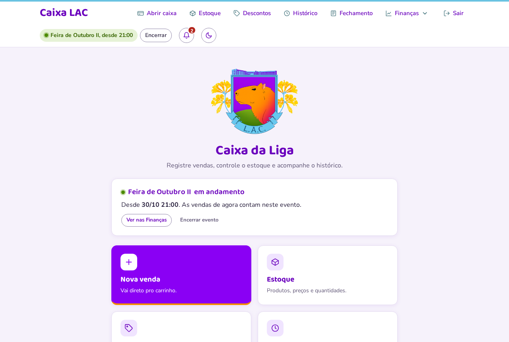
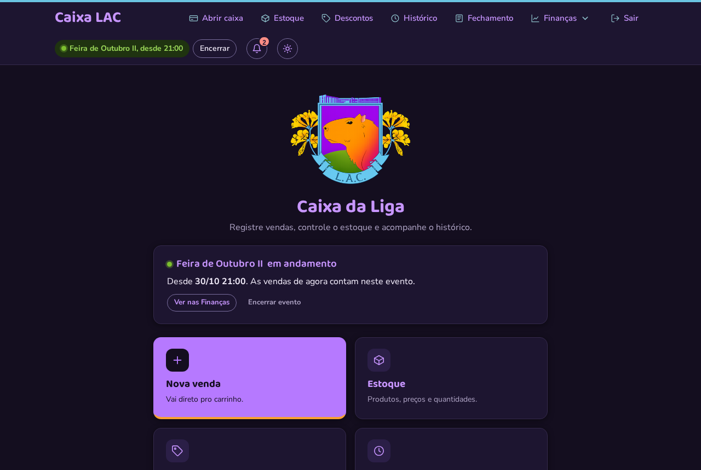
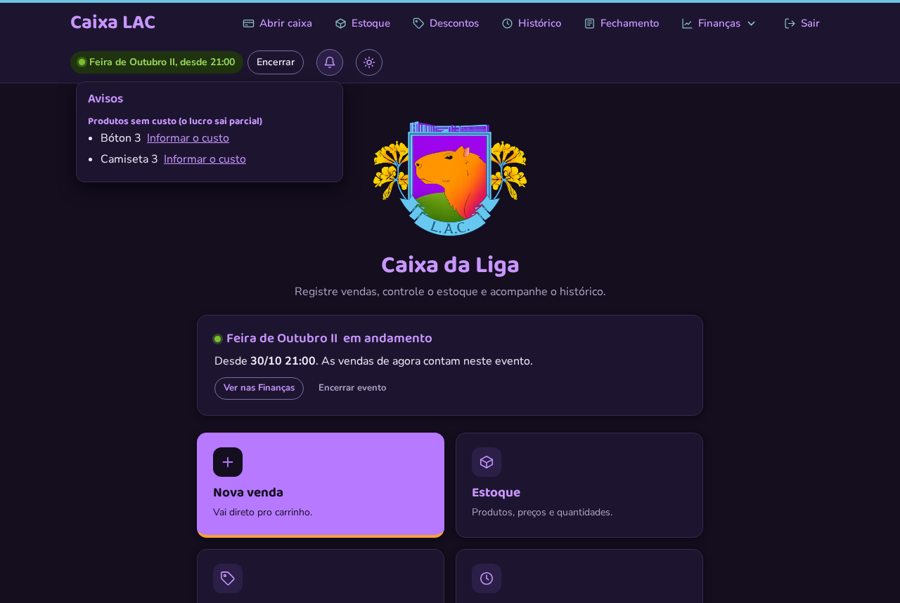
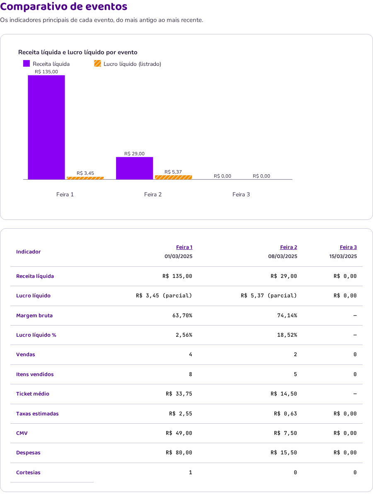
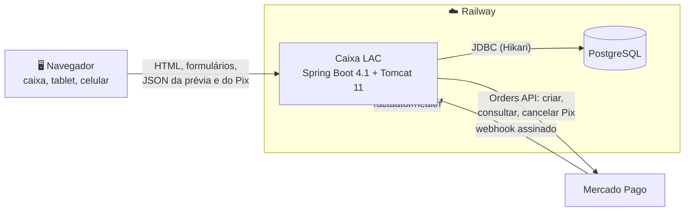
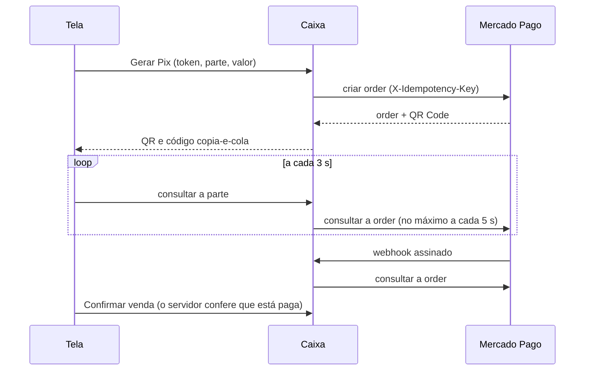

<div align="center">


# Caixa LAC

**O caixa da Liga Acadêmica de Computação:** vendas, Pix, estoque e finanças de feiras e eventos, direto do navegador.


<br>



</div>

---

## O que o caixa faz

| | |
|---|---|
| **Vender** | Busca de produtos, total na hora com as promoções (o cliente sempre paga o menor total), pagamento em Pix, débito, crédito, dinheiro com troco ou "outro", **pagamento dividido**, ajuste com motivo e cortesia. |
| **Pix automático** | Com o Mercado Pago ligado, a tela mostra o QR Code e confirma sozinha quando o pagamento cai. Sem ele, o Pix é conferido à mão. |
| **Estoque e promoções** | Produtos por categoria, custo médio pelas compras, limite de estoque baixo, livro de movimentos e promoções "a partir de N" ou em pacote. |
| **Histórico e fechamento** | Filtros por dia, forma, produto e evento; correção de data; cancelamento com motivo; fechamento por forma de pagamento (Pix do Mercado Pago separado do manual); CSV. |
| **Eventos** | "Iniciar evento" com um toque, relatório para imprimir e comparativo entre eventos. Fora deles é o "dia a dia". |
| **Finanças** | Receita, CMV, margem, taxas, despesas e lucro; gráficos, rankings, curva ABC, mapa de calor, giro de estoque e metas. Toda tabela exporta CSV. |
| **Avisos** | O sininho avisa estoque acabando, produto sem custo, ajustes do dia, fechamento que não bate, evento esquecido e Pix estornado. |
| **Segurança** | Senha do grupo só em variável de ambiente, freio contra tentativas, sessão de um dia de evento, proteção contra formulários de outros sites e auditoria. |

## Telas

<table>
  <tr>
    <td width="66%"></td>
    <td width="34%" align="center"></td>
  </tr>
  <tr>
    <td align="center"><sub>Tema escuro, com o evento em andamento no topo</sub></td>
    <td align="center"><sub>No celular</sub></td>
  </tr>
  <tr>
    <td></td>
    <td align="center"></td>
  </tr>
  <tr>
    <td align="center"><sub>Sininho de avisos</sub></td>
    <td align="center"><sub>Comparativo de eventos (impressão)</sub></td>
  </tr>
</table>


## Stack

| Camada | Tecnologia | Versão |
|---|---|---|
| Linguagem | Java | 21 |
| Framework | Spring Boot · Spring Framework (MVC, transações, `RestClient`) | 4.1.2 · 7.0 |
| Servidor | Tomcat embutido | 11.0 |
| Telas | Thymeleaf · CSS próprio (tema claro/escuro) · JavaScript sem framework | 3.1 |
| Gráficos | Chart.js, embutido no projeto (sem CDN) | 4.4.1 |
| JSON | Jackson 3 | 3.1 |
| Persistência | Spring Data JPA · Hibernate ORM · Jakarta Persistence · HikariCP | 4.1 · 7.4 · 3.2 · 7.0 |
| Banco | PostgreSQL em produção · H2 em arquivo no computador | 16 · 2.3.232 |
| Migrações | Flyway (`flyway-database-postgresql`) | 12.4 |
| Pagamentos | Mercado Pago, Orders API (Pix), webhook com HMAC-SHA256 | |
| Saúde | Spring Boot Actuator, só `/actuator/health` | 4.1 |
| Testes | JUnit · Mockito · Testcontainers · Playwright · OkHttp MockWebServer · ArchUnit (e MockMvc do Spring) | 6.0 · 5.23 · 2.0 · 1.64 · 4.12 · 1.5 |
| Qualidade | Spotless (palantir-java-format) · JaCoCo | 3.10 · 0.8.16 |
| Build e CI | Maven Wrapper (Maven 3.9.9) · GitHub Actions | |
| Hospedagem | Railway (Railpack) com healthcheck | |

## Arquitetura

Um monólito Spring Boot renderizado no servidor, com um pouco de JavaScript nas
telas que precisam reagir na hora (venda, Pix, gráficos, avisos). Um processo,
um banco.



```
src/main/java/br/com/lac/caixa/
├── config/        senha, freio de login, filtro de origem, relógio, dados iniciais
├── controle/      controllers MVC e JSON, um por tela
│   └── csv/       geração e download dos CSVs
├── servico/       regras de negócio e transações
│   ├── preco/     calculadora de preço e busca de pacotes (Java puro)
│   └── financas/  contas das finanças, por assunto
├── consulta/      filtros (histórico, finanças, período do evento)
├── repositorio/   Spring Data, Specifications, Criteria e SQL das finanças
├── modelo/        entidades JPA com as regras de cada uma
│   └── pagamento/ Strategy de descrição de cada forma de pagamento
├── dominio/       exceções de negócio
├── pix/           cliente do Mercado Pago e assinatura do webhook
└── util/          Dinheiro, Rateio, GraficoSvg

src/main/resources/
├── db/migration/            migrações comuns (H2 e PostgreSQL)
├── db/migration-postgresql/ migrações só do PostgreSQL
├── templates/               telas Thymeleaf
└── static/                  css, js (venda, venda-pix, financas, avisos) e imagens
```

**Regras de dependência**, conferidas em todo build pelo `ArquiteturaTest` (ArchUnit):
nenhum ciclo entre pacotes; `modelo` não conhece serviço, banco nem web;
`repositorio` não conhece serviço nem controle; `servico` não conhece controle;
`controle` não conhece repositório; `util` não depende de ninguém do projeto.

**Padrões de POO** (o projeto nasceu como trabalho da disciplina):
**Strategy** em `modelo/pagamento/` (cada forma de pagamento sabe se descrever
a partir de `DadosDaParte`), **Factory** (`PagamentoFactory`), **Singleton**
(cada `@Service` do Spring), **records** para filtros, orçamentos e resultados,
e `RegraDeNegocioException` para a mensagem que vai para a pessoa no caixa.

## Como funciona por dentro

<details>
<summary><b>Venda</b></summary>

1. A tela abre com um **token** novo; reenviar o mesmo formulário nunca cria
   outra venda.
2. A cada mudança no carrinho, `POST /venda/previa` devolve o orçamento calculado
   no servidor. O navegador nunca calcula preço.
3. `POST /venda`, numa transação: confere o orçamento e o ajuste, confere o
   pagamento (soma exata, troco, Pix pago com o mesmo valor), grava a taxa de
   cada parte, baixa o estoque com um `UPDATE` atômico, rateia o desconto entre
   os itens pelo maior resto e grava a auditoria.
4. Recusada (estoque acabou, Pix não pago), a tela volta com o mesmo carrinho.

</details>

<details>
<summary><b> Calculadora de preço</b></summary>

Java puro, sem Spring nem banco. O cliente paga o **menor total possível** e cada
unidade entra em **no máximo uma promoção**. As `A_PARTIR_DE` que não disputam
categoria com pacotes entram direto; as outras são combinadas, e para cada
combinação a `BuscaDePacotes` escolhe os pacotes por programação dinâmica, só
sobre os estados alcançáveis. Carrinho grande demais usa uma heurística e marca
o orçamento como aproximado, sem recusar a venda. Um teste compara com uma força
bruta independente em carrinhos aleatórios.

</details>

<details>
<summary><b>Pix pelo Mercado Pago</b></summary>



- Nenhuma chamada ao Mercado Pago com a linha do banco travada: consulta primeiro
  e aplica depois, numa transação curta.
- A cobrança só vira **paga** com o valor exato; estorno e contestação viram
  **estornada**, mesmo depois de paga.
- Dois "Gerar Pix" da mesma parte ao mesmo tempo não perdem order: a que perde a
  corrida é cancelada no Mercado Pago.
- O webhook confere o `x-signature` (HMAC-SHA256), responde na hora e trabalha em
  segundo plano.
- Pendências velhas são encerradas a cada 5 minutos; Pix pago sem venda aparece
  no histórico para alguém resolver.

</details>

<details>
<summary><b>Finanças</b></summary>

As somas são feitas no banco, em SQL que roda igual no PostgreSQL e no H2. Os
serviços de `servico/financas/` cuidam de arredondamento, percentuais e
ordenação: `ResumoFinanceiro`, `SerieFinanceira`, `RankingsFinanceiros`,
`EstoqueFinanceiro` e `OcorrenciasFinanceiras`. O `PainelFinancas` monta a tela
buscando cada consulta uma vez, e o `RelatorioDoEvento` gera o relatório com
gráficos em SVG para imprimir. Um teste conta as consultas de cada pedido e trava
o máximo.

</details>

<details>
<summary><b>Persistência e concorrência</b></summary>

- O **Flyway** é dono do esquema; o Hibernate só valida (`ddl-auto=validate`).
  Migração aplicada nunca é editada.
- Quatro jeitos de consultar, cada um onde serve melhor: Spring Data com JPQL,
  `Specification` no filtro do histórico, Criteria nas somas e
  `NamedParameterJdbcTemplate` nas agregações das finanças.
- Versão otimista em produto e venda, baixa de estoque atômica, trava pessimista
  na venda e na cobrança Pix, índice único no token da venda e um só evento
  aberto por vez (índice parcial no PostgreSQL).
- `CHECK`s, chaves estrangeiras e `NOT NULL` no banco, além das validações no
  serviço. `open-in-view` desligado.

</details>

<details>
<summary><b>Segurança</b></summary>

- Senha única do grupo (`APP_SENHA`), obrigatória e comparada em tempo constante;
  sem ela o app não sobe.
- Freio de tentativas por IP (espera progressiva, bloqueio, IPv6 por /64, teto
  global por minuto).
- Sessão só por cookie, 12 h, `SameSite=Strict` e `Secure` em produção; logout só
  por POST.
- POST de outro site recusado (`Sec-Fetch-Site` e `Origin`).
- Segredos só em variáveis de ambiente, nunca no código nem no log.
- CSV protegido contra fórmulas de planilha.
- Auditoria de vendas, ajustes, cancelamentos e cadastros.
- Do Actuator, só `{"status":"UP"}` em `/actuator/health`.

</details>


## Rodar no computador

Precisa de **Java 21+**. O Maven vem junto (Maven Wrapper).

```bash
# 1. a senha de acesso (mínimo de 8 caracteres)
export APP_SENHA='uma-senha-sua'      # PowerShell: $env:APP_SENHA='uma-senha-sua'
# ou: echo "APP_SENHA=uma-senha-sua" > senha-local.properties

# 2. subir
./mvnw spring-boot:run                # Windows: mvnw.cmd spring-boot:run
```

Abra **http://localhost:8080**. No computador o banco é um H2 em arquivo na pasta
`./dados/`, com alguns produtos de exemplo na primeira vez; o console do H2 fica
em `/h2-console` (JDBC URL `jdbc:h2:file:./dados/caixa`, usuário `sa`, senha em
branco).

| Perfil | Banco | Uso |
|---|---|---|
| `local` (padrão) | H2 em arquivo, só em 127.0.0.1 | desenvolvimento |
| `prod` | PostgreSQL do Railway | produção |
| `test` | H2 em memória ou PostgreSQL (Testcontainers) | a suíte de testes |

> [!TIP]
> Coloque `logo.png` (início e login) e `caixa.png` ("Abrir caixa") em
> `src/main/resources/static/img/`. Sem eles, aparece um 🦫.

## Testes

```bash
./mvnw -B verify
```

| Tipo | O que garante |
|---|---|
| Unidade | regras das entidades, calculadora (inclusive contra força bruta), rateio, freio de login |
| Serviço e HTTP (MockMvc) | fluxos completos das telas, mensagens, CSVs e a segurança de todas as rotas |
| Massa fixa das finanças | resultados calculados à mão, no H2 e no PostgreSQL |
| Saídas esperadas | JSON da prévia, das finanças e do Pix, o corpo enviado ao Mercado Pago e o CSV, iguais byte a byte |
| PostgreSQL real (Testcontainers) | migração de um banco legado e de um vazio, filtros e planos de consulta |
| Navegador (Playwright) | venda dividida, Pix, finanças, sininho e evento rápido num Chromium |
| Arquitetura (ArchUnit) | as regras de dependência entre pacotes |

O `verify` também roda o **Spotless** (formatação; para corrigir,
`./mvnw spotless:apply`) e gera a cobertura do **JaCoCo** em
`target/site/jacoco/index.html`. O Mercado Pago nunca é chamado de verdade: os
testes usam um servidor falso. Sem Docker ou sem navegador, esses testes são
pulados no computador; no **GitHub Actions** a falta deles é erro.


## Regras de negócio

<details>
<summary><b>Preço e promoção</b></summary>

- A calculadora é a única fonte dos valores. Produto sem categoria não entra em promoção.
- **A_PARTIR_DE:** atingido o mínimo de cada categoria do combo, todas as unidades
  delas saem pelo preço promocional (só onde ele é mais barato) e não entram em pacote.
- **PACOTE:** as unidades que sobraram formam pacotes, cada um com as mais caras;
  o resto sai no preço normal.
- Exemplo, bóton de R$ 6, "a partir de 2 por R$ 5" e "3 por R$ 12":
  3 bótons = **R$ 12**, 4 = **R$ 18**, 6 = **R$ 24**.
- Empate: menos `A_PARTIR_DE` e, entre pacotes, o de menor id. A ordem de cadastro não importa.
- **Valor ajustado:** diferente do calculado exige motivo; zero é cortesia; negativo não pode.

</details>

<details>
<summary><b>Pagamento</b></summary>

- Uma forma só, sem valor, paga o total (um toque). Dividido: até 10 partes,
  somando **exatamente** o valor cobrado.
- Troco só em dinheiro; "Outro" exige descrição; cortesia não tem pagamento.
- Pix do Mercado Pago só vale pago com o mesmo valor, conferido de novo ao confirmar.
- A taxa estimada de cada parte é a vigente no dia da venda.

</details>

<details>
<summary><b>Histórico, cancelamento e fechamento</b></summary>

- Filtro por forma traz a venda se **qualquer** parte usou a forma; busca por
  produto sem diferenciar maiúsculas nem acentos; 50 vendas por página, totais
  do filtro inteiro.
- Corrigir a data recusa futuro e venda cancelada, e recalcula a taxa.
- Cancelar exige motivo, devolve o estoque uma vez e tira a venda de todos os totais.
  O reembolso é feito fora do caixa.
- No fechamento, a soma das formas tem que bater com o total cobrado; se não
  bater, a tela e o sininho avisam.

</details>

<details>
<summary><b>Estoque, eventos, despesas e finanças</b></summary>

- O estoque nunca fica negativo; produto com vendas é arquivado, não apagado.
- A compra recalcula o custo médio (4 casas); o item da venda congela preço e custo.
- Evento é `[início, fim)`; só um em andamento, que vale até agora ou até o
  próximo marcado. A venda não guarda o evento: ele vem da data e hora.
- Despesa ligada a evento conta no dia em que ele começa; sem evento, na data dela.
- Período de até 3 anos; série por hora, dia, semana ou mês conforme o tamanho;
  comparação com o período anterior cortado no mesmo horário.

</details>

